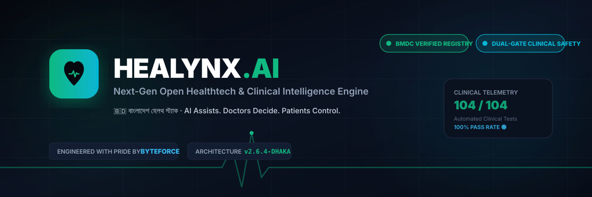
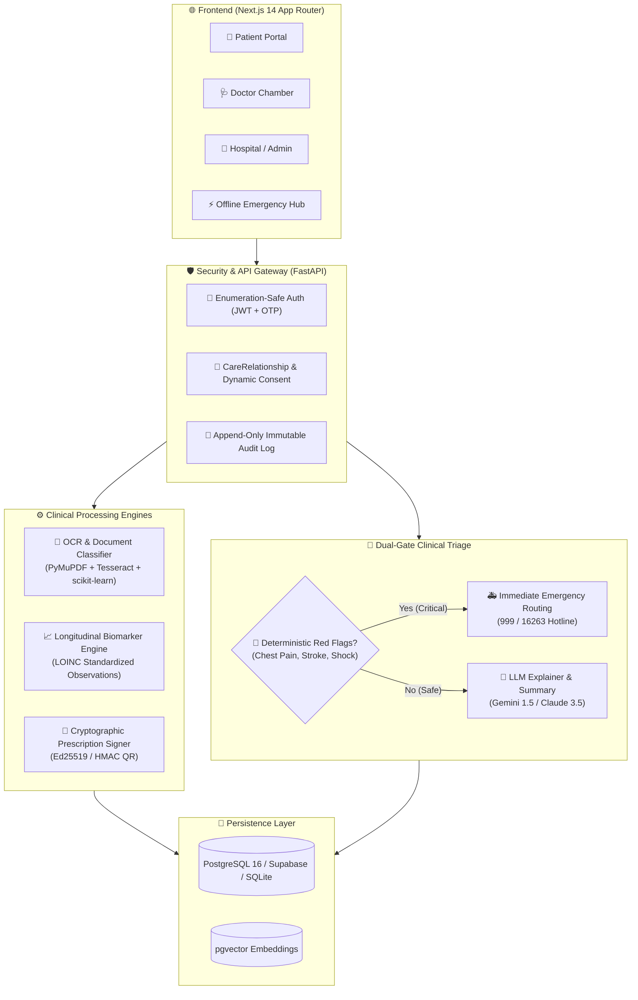

# 🌿 HEALYNX-AI (হিলিংক্স এআই)

<div align="center">



### **Next-Generation Open Clinical Intelligence & Healthcare Orchestration Engine for Bangladesh**
*Engineered with pride by **ByteForce***

> **"AI assists. Doctors decide. Patients stay in control."**  
> *কৃত্রিম বুদ্ধিমত্তা সহায়তা করবে, সিদ্ধান্ত নেবেন চিকিৎসক, নিয়ন্ত্রণ থাকবে রোগীর হাতে।*

<br/>

[-brightgreen?style=for-the-badge&logo=pytest&logoColor=white)](#-testing--verification)
[](#-testing--verification)
[](https://fastapi.tiangolo.com)
[](https://nextjs.org)
[](https://python.org)
[](https://www.typescriptlang.org)
[](https://tailwindcss.com)
[](https://supabase.com)
[](https://ai.google.dev/)
[](https://anthropic.com)
[](#-key-capabilities)
[](LICENSE)

<br/>

[🌟 Features](#-key-capabilities) • [🏗️ Architecture](#️-system-architecture) • [🚀 Quick Start](#-quick-start) • [🧪 Testing](#-testing--verification) • [🛡️ Safety & Gates](#️-clinical-safety--audit-framework) • [👥 ByteForce](#-built-by-byteforce)

---

</div>

## 📌 Executive Overview

In Bangladesh, healthcare remains fragmented across paper prescriptions, siloed diagnostic labs, and unstructured reports. Patients carry heavy polybags of paper history, doctors lack longitudinal trends during 3-minute consultations, and emergency responders have zero offline access to critical medical IDs.

**HEALYNX-AI (হিলিংক্স এআই)** bridges this divide. It is a full-stack, open-standard clinical orchestration platform tailored specifically for the healthcare realities of Bangladesh:
- 🇧🇩 **Bangla + English Bilingual Interface** with culturally adapted triage logic.
- 🩺 **Deterministic Clinical Safety Gates**: Emergency red flags bypass AI completely and trigger immediate hospital routing.
- 📊 **Longitudinal Trend Studio**: Tracks CBC, Blood Glucose, HbA1c, and Lipid profiles across years and multiple diagnostic providers.
- 🧾 **Counterfeit-Proof Cryptographic Prescriptions**: Signed with Ed25519/HMAC QR codes for instant pharmacy verification.
- ⚡ **Zero-Login Emergency First-Aid Hub**: 100% offline-capable life support protocols, national hotlines (999, 16263, 10655), and dynamic Medical ID QR.

---

## 🏗️ System Architecture

HEALYNX-AI employs a **Dual-Gate Safety & Privacy Architecture**. Sensitive medical data is isolated under strict consent relationships, and all AI interactions pass through deterministic clinical safety filters.



---

## 🌟 Key Capabilities

### 1. 📈 Longitudinal Biomarker Trend Studio (`/timeline`)
- Converts fragmented blood test PDFs and images into continuous, standardized clinical time-series.
- Tracks **Hemoglobin, Platelets, WBC, RBC, Fasting Blood Sugar (FBS), and 2hr PP Glucose**.
- Dynamic normal reference ranges with warning badges (Low / Normal / High) and clinician sparkline trajectory insights.

### 2. 🧾 Verifiable Cryptographic Prescriptions (`/prescriptions`)
- BMDC-certified digital prescriptions with tamper-evident digital signatures.
- **Scannable QR Verification**: Pharmacies scan the QR to inspect prescription authenticity and prevent unauthorized medication reuse.
- **Dispensation State Machine**: Tracks pending, partially dispensed, and fully fulfilled medications.

### 3. 📹 Live Doctor Chamber & Virtual Queue (`/appointments`)
- Real-time chamber status: **Live Now**, **Starting Soon**, or **Completed**.
- Dynamic countdown timers for upcoming consultations with 1-click WebRTC teleconsultation chamber launch.
- Two-way appointment confirmation: doctor acceptance activates clinical consent.

### 4. ⚡ 100% Offline Emergency First-Aid Hub (`/emergency`)
- Immediate guidance for life-threatening emergencies: **Cardiac Arrest (CPR), Snakebite, Severe Burns, Heatstroke, and Electrocution**.
- **Role-Based Medical ID**:
  - Logged-in patients see their live Emergency QR, blood group, allergies, and emergency contacts.
  - Guests and first-time users can access emergency first aid without logging in.
- One-tap national emergency calling: **999 (National Emergency)**, **16263 (Shastho Batayen)**, **10655 (IEDCR)**.

### 5. 🤖 Dual-Gate Triage & SmartCare Navigator (`/navigator`)
- **Gate 1 (Deterministic)**: 30+ rule-based clinical red flags (e.g. crushing chest pain, sudden slurred speech, high fever with stiff neck). If detected, all LLM inference is bypassed and emergency protocols are triggered.
- **Gate 2 (AI Explainer)**: Plain-language, culturally nuanced health explanations powered by Google Gemini 1.5 and Claude 3.5 with strict human-in-the-loop clinician disclaimers.

### 6. 📄 Diagnostic Lab OCR & Multilingual Parser (`/reports/scan`)
- Pre-trained models optimized for Bangladeshi diagnostic lab formats (Popular Diagnostic, Square Hospitals, Ibn Sina, Labaid, etc.).
- Dual PDF stream: native vector PDF text extraction via PyMuPDF + scanned image OCR fallback via Tesseract.

### 7. 🏥 Hospital-Wise Clinical Directory (`/directory`)
- Verified directory of 40+ doctors and 10+ hospitals across Dhaka and regional divisions.
- Filter by specialty, chamber location, consultation fee (BDT), and verification badge.

---

## 🚀 Quick Start

### Option A: Local Native Setup (Recommended)

Requires **Python 3.12+** and **Node.js 18+**.

```bash
# 1. Clone repository
git clone https://github.com/abid-222/HEALYNX-AI.git
cd HEALYNX-AI

# 2. Automated environment setup & dependencies
make setup

# 3. Seed synthetic demo database (SQLite)
make seed

# 4. Launch backend (FastAPI at http://localhost:8000)
make api

# 5. Launch frontend (Next.js at http://localhost:3000)
make web
```

### Option B: Docker Compose

```bash
docker compose up --build
```
- Web Application: `http://localhost:3000`
- API Documentation (Swagger/OpenAPI): `http://localhost:8000/docs`

---

## 👥 Demo Credentials

All accounts use the unified demo password: `Demo@12345`

| Role | Email | Description / Use Case |
|---|---|---|
| **Patient** | `patient1@demo.medibridge.dev` | View Timeline, Prescriptions, Appointments & Medical ID |
| **Doctor** | `doctor1@demo.medibridge.dev` | Chamber management, Clinical Notes, Rx signing |
| **Hospital Admin** | `hospital@demo.medibridge.dev` | Facility services, doctor affiliations, queue |
| **System Admin** | `admin@demo.medibridge.dev` | BMDC verification audit, system telemetry, break-glass |

> 💡 *In `dev` mode, newly registered accounts show their 6-digit OTP directly on screen for rapid testing.*

---

## 🧪 Testing & Verification

Niramoy AI enforces rigorous end-to-end testing across both backend and frontend layers:

```bash
# Run full backend test suite (104 tests)
pytest apps/api -q

# Run frontend unit & integration tests (17 tests)
npm --prefix apps/web test -- --run

# Complete verification check (i18n, types, linter)
make check
```

### Verification Scorecard

| Suite | Scope | Tests | Result |
|---|---|---|---|
| **Backend (pytest)** | Auth, Consent, Triage Gates, OCR, Full E2E Journey | **104** | 🟢 **100% Passed** |
| **Frontend (Vitest)** | API Client, Formatting, Auth Tokens, State Machine | **17** | 🟢 **100% Passed** |
| **Safety Guardrails** | Red-Flag Bypasses, Consent Enforcing, RBAC | **28** | 🟢 **100% Passed** |

---

## 🛡️ Clinical Safety & Audit Framework

1. **AI Never Prescribes**: HEALYNX-AI is an assistive decision-support framework. It does not provide diagnoses, final prescriptions, or dosage determinations.
2. **Deterministic Pre-emption**: Red-flag symptom checks occur in pure Python code before any AI model is invoked.
3. **Immutable Audit Trail**: Every data access, consent grant, and clinical note revision is recorded in an append-only audit log with SHA-256 integrity checks.
4. **Account Enumeration Protection**: Authentication endpoints return identical generic responses for both registered and unregistered identifiers.

---

## 📂 Project Organization

```text
healynx/
├── apps/
│   ├── api/                     # FastAPI Backend
│   │   ├── app/
│   │   │   ├── modules/         # Modular feature architecture
│   │   │   │   ├── appointments/# Chamber queue & booking state machine
│   │   │   │   ├── auth/        # Enumeration-safe OTP authentication
│   │   │   │   ├── clinical_notes/# Doctor draft, sign & addendum engine
│   │   │   │   ├── consent/     # Explicit patient-doctor data sharing
│   │   │   │   ├── directory/   # Doctor & hospital registry
│   │   │   │   ├── emergency/   # First aid protocols & emergency sync
│   │   │   │   ├── navigator/   # Dual-gate clinical triage & AI explainer
│   │   │   │   ├── prescriptions/# Cryptographic QR prescription signer
│   │   │   │   └── timeline/    # Longitudinal biomarker trend engine
│   │   │   └── main.py          # FastAPI application entrypoint
│   │   └── tests/               # 104 comprehensive pytest unit & E2E tests
│   │
│   └── web/                     # Next.js 14 Frontend (App Router)
│       ├── app/                 # Routes: /timeline, /prescriptions, /appointments, /emergency, /directory
│       ├── components/          # Reusable UI component library (TailwindCSS)
│       └── lib/                 # Auth store, API client, formatting utilities
│
├── supabase/migrations/         # PostgreSQL DDL, RLS policies, audit triggers
├── data/                        # Synthetic clinical fixtures & ML classifier training sets
├── docs/                        # Clinical blueprint, safety specifications, demo walkthroughs
└── Makefile                     # Unified development workflow commands
```

---

## 👥 Built by ByteForce

Crafted with dedication by **Team ByteForce**:
- **System Architecture & Full-Stack Engineering**
- **Clinical AI Safety Engineering & ML Pipeline**
- **UI/UX & Accessibility Design**

---

<div align="center">

**HEALYNX-AI** · Empowering healthcare across Bangladesh with transparency, safety, and intelligence.

*Licensed under the [MIT License](LICENSE).*

</div>
